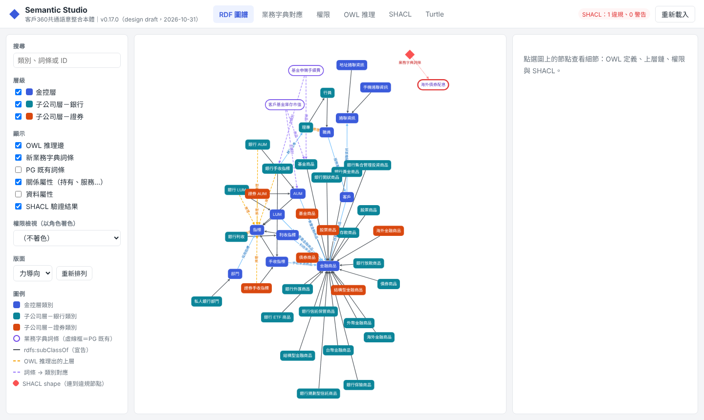
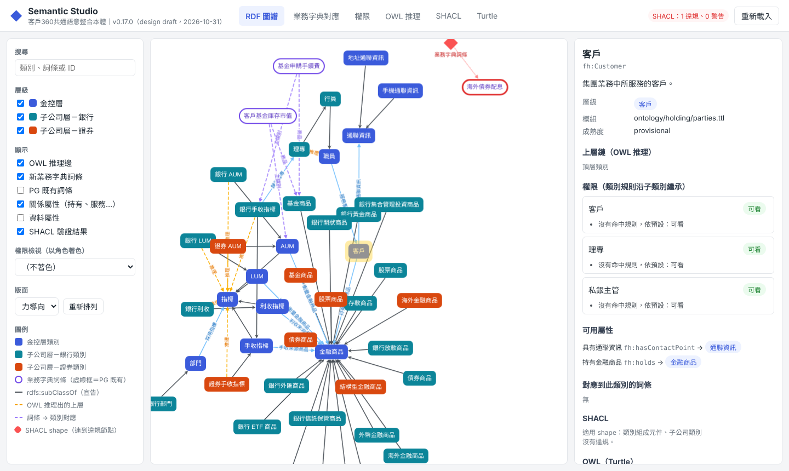
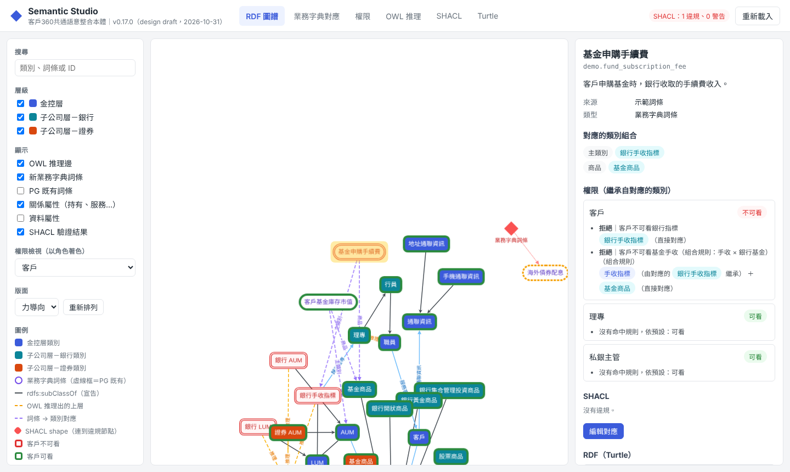
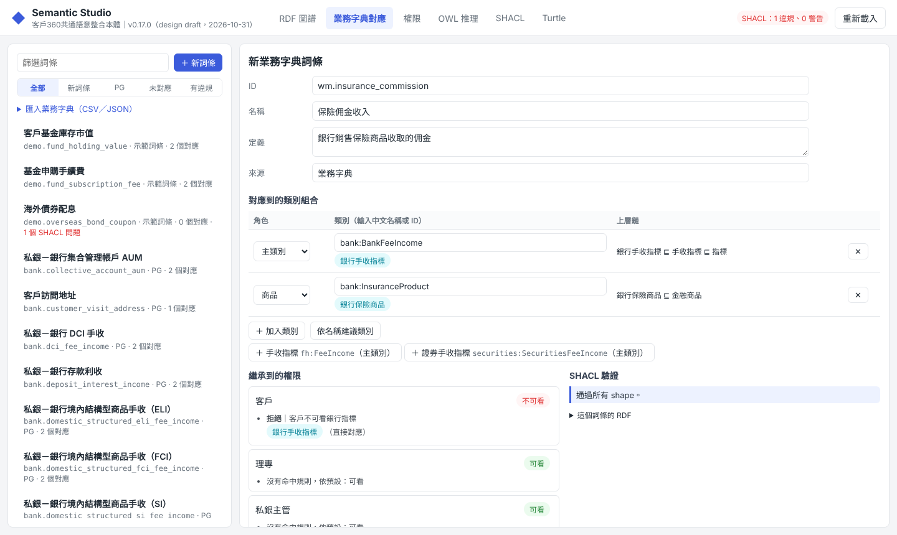
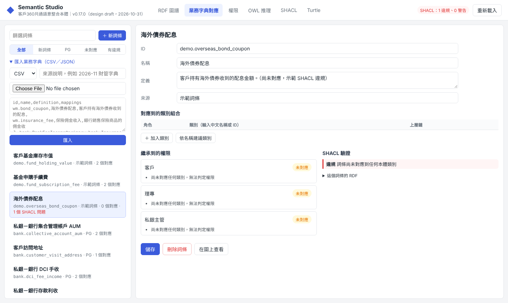
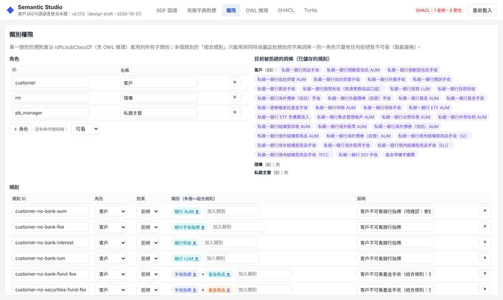
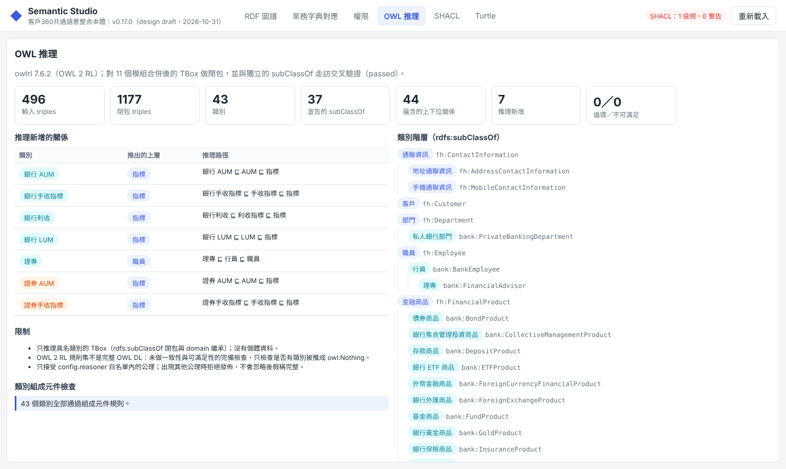
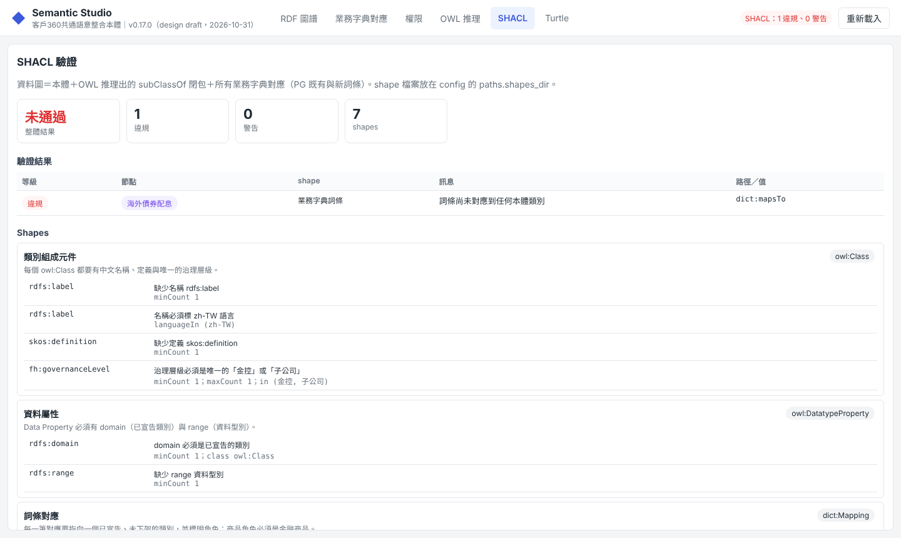
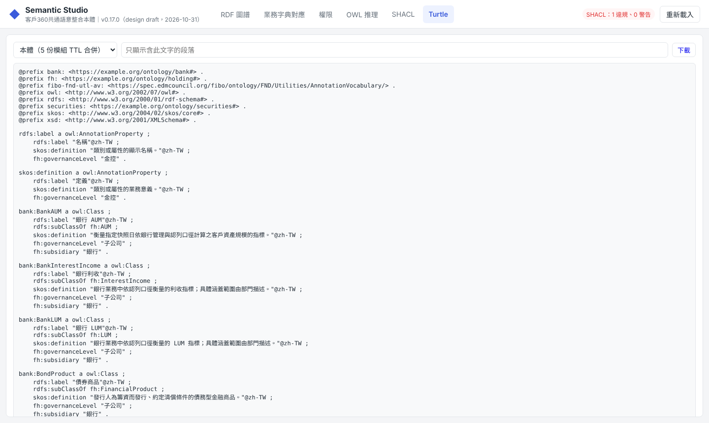

# 交接說明：客戶360 本體（給第一次接手的人）

> 這份文件用白話寫，不需要先懂 RDF。照順序讀完大約 20 分鐘。
> 技術細節在同資料夾的 [README.md](README.md)，有需要再查。

---

## 1. 這個專案在做什麼？

公司裡同一個東西常有很多種講法。「基金手收」「基金申購手續費」「私銀－銀行基金手收」，到底是不是同一件事？屬於銀行還是證券？客戶看得到嗎？

這個專案就是一本**全公司共用的「名詞字典＋關係圖」**，正式名稱叫「本體」（ontology）。它把這些事寫清楚：

- **有哪些東西**：客戶、理專、金融商品、AUM、手收……我們叫它「類別」。
- **東西之間的關係**：「客戶 **持有** 金融商品」「銀行手收指標 **是一種** 手收指標」。
- **誰可以看什麼**：例如「客戶不可看銀行指標」「客戶不可看基金手收」。

做出來的東西主要給 **AI agent** 用。我們把它整理成一份文字說明（`agent-context.md`），放進 AI 的提示詞裡。這樣 AI 回答問題時，用的名詞和推理方式都跟公司定義一致。

### 三層架構

| 層 | 例子 | 用什麼寫 |
|---|---|---|
| 金控層 | 客戶、金融商品、指標、AUM | RDF（`ontology/holding/`） |
| 子公司層 | 銀行的基金商品、證券的債券商品 | RDF（`ontology/bank/`、`ontology/securities/`） |
| 部門層 | 私銀部門實際在用的指標欄位 | 屬性圖 PG（`pg/`） |

### 名詞小抄

| 名詞 | 白話解釋 |
|---|---|
| RDF | 一種「主詞－動詞－受詞」的資料格式，例如「理專 是一種 行員」 |
| TTL（Turtle） | RDF 的文字檔寫法，副檔名 `.ttl`，用記事本就能打開 |
| 類別（Class） | 一種「東西」，例如「客戶」「基金商品」 |
| 屬性（Property） | 東西之間的關係（例如「持有」），或東西身上的欄位 |
| OWL 推理 | 電腦自動推出沒寫明的結論。寫了「銀行手收 是一種 手收」「手收 是一種 指標」，它會推出「銀行手收 是一種 指標」 |
| SHACL | 自動檢查規則，像表單驗證。例如「每個類別都要有中文名稱」 |
| PG（屬性圖） | 部門層的資料模型，放在 `pg/`，平常不太需要動 |
| 業務字典詞條 | 業務單位實際在講的名詞，例如「基金申購手續費」。我們把它**對應**到一個或多個類別 |
| 權限規則 | 某個角色（客戶／理專／私銀主管）能不能看某類東西 |
| 版號、release | 本體每次改動都要升版號（例如 0.17.0 → 0.18.0），再「發佈」成一包固定不變的檔案 |

---

## 2. 資料夾地圖：哪些可以動、哪些不要碰

```
customer360-rdf/
├── HANDOFF.md            ← 你正在看的這份
├── README.md             ← 技術說明
├── config.yaml           ← 總設定：版號、路徑、模組清單（升版時由指令自動改）
├── ontology/             ← ✏️ 本體本體：所有類別與關係（.ttl）
│   ├── holding/          　金控層
│   ├── bank/             　銀行
│   └── securities/       　證券
├── dictionary/terms.yaml ← ✏️ 業務字典詞條（建議用 Studio 改）
├── policy/access-policy.yaml ← ✏️ 權限規則（建議用 Studio 改）
├── shapes/               ← ✏️ SHACL 檢查規則（偶爾才需要加）
├── pg/                   ← 部門層屬性圖（升版時跑兩支腳本即可）
├── scripts/              ← ▶️ 啟動 Studio 的捷徑（Mac／Windows）
├── src/                  ← 程式碼（不改功能就不用動）
├── tests/                ← 自動測試
├── build/                ← 🚫 自動產生，不要手改
├── release/              ← 🚫 已發佈的版本，永遠不要改
└── legacy/               ← 🚫 舊版封存，測試會用到，不要改也不要刪
```

規則很簡單：
- ✏️ 是平常會改的。
- 🚫 是不要手動碰的。
- 其他沒事不用管。

---

## 3. 第一次使用：打開 Semantic Studio

Semantic Studio 是這個專案的**視覺化網頁介面**。看圖譜、加詞條、改權限，都在這裡做。

### 準備（只要做一次）

1. 安裝 **Python 3.10 以上**。
   - Mac：打開「終端機」輸入 `python3 --version`，有顯示 3.10 以上就好。沒有的話，到 https://www.python.org/ 下載安裝。
   - Windows：安裝時記得勾「Add python.exe to PATH」。
2. 第一次啟動會自動下載需要的套件，**要能連網**，大約 1～2 分鐘。

### 啟動

| 電腦 | 怎麼做 |
|---|---|
| Mac | 到 `customer360-rdf/scripts/`，雙擊 **`start-studio.command`** |
| Windows | 到 `customer360-rdf\scripts\`，雙擊 **`start-studio.cmd`** |

會跳出一個黑色視窗（終端機），接著瀏覽器自動打開 **http://127.0.0.1:8870/**。

- **黑色視窗不要關**，關掉 Studio 就停了。用完再關掉即可。
- Mac 第一次雙擊如果出現「無法打開，因為來自未識別的開發者」：
  1. 對檔案按右鍵（或 Control＋點一下），選「打開」。
  2. 再按一次「打開」。
  3. 之後就可以直接雙擊。
- 如果瀏覽器沒自動打開，自己在瀏覽器輸入 `http://127.0.0.1:8870/`。
- 這個網址只有你自己的電腦連得到，別人連不進來。

---

## 4. Studio 導覽（六個分頁）

畫面最上方有六個分頁。右上角的紅字（例如「SHACL：1 違規、0 警告」）是目前的檢查結果，**重新載入**按鈕會重新讀取硬碟上的檔案。

### 4.1 RDF 圖譜：看整張關係圖



- 方塊是**類別**，顏色代表層級：藍＝金控、綠＝銀行、橘＝證券。
- 紫色圓角框是**業務字典詞條**。
- 線的種類：
  - 黑實線：「是一種」（例如 銀行 AUM → AUM）。
  - 橘虛線：OWL 推理推出來的關係。
  - 紫虛線：詞條對應到的類別。
  - 藍線：關係屬性（例如 客戶 → 持有 → 金融商品）。
- 紅色菱形是 **SHACL 檢查不通過**的地方，會連到出問題的節點。
- 左邊可以搜尋、勾選要顯示哪些東西、切換版面。

**點任何一個節點**，右邊會出現它的詳細資料：定義、上層、各角色能不能看、可用的關係、SHACL 結果。



**用角色著色**：左邊「權限檢視」選一個角色（例如「客戶」），整張圖會依「看得到／看不到」上色。再點詞條，就能看到它被哪條規則擋下。



### 4.2 業務字典對應：新增詞條、對應到類別

這是最常用的分頁。新詞條**不用寫權限**：它對應到哪些類別，就自動繼承那些類別的權限。



步驟：
1. 按右上的 **＋ 新詞條**。
2. 填 **ID**（英文小寫加點，例如 `wm.insurance_commission`）、**名稱**、**定義**、**來源**。
3. 在「對應到的類別組合」按 **＋ 加入類別**。每一列要選兩樣：
   - **角色**：
     - 主類別：這個詞條「是什麼」，例如手收指標。
     - 商品：跟哪種商品有關，例如保險商品。
     - 業務範圍、其他：視需要使用。
   - **類別**：輸入中文名稱或 ID，會出現候選清單。
   - 不知道該對哪個，可以按 **依名稱建議類別**，系統會依名稱猜幾個給你挑。
4. 下方會**即時**顯示：
   - 「繼承到的權限」：每個角色能不能看，以及原因。
   - 「SHACL 驗證」：有沒有填錯。
5. 確認沒問題後，按頁面最下方的 **儲存**。資料會寫進 `dictionary/terms.yaml`。

左邊清單上方的小分頁可以篩選：新詞條、PG 既有、未對應、有違規。

**一次匯入很多詞條**：點左邊「匯入業務字典（CSV／JSON）」，可以貼上內容或選檔案。



CSV 格式（第一行是標題）：

```csv
id,name,definition,mappings
wm.insurance_fee,保險佣金收入,銀行銷售保險商品收取的佣金,bank:BankFeeIncome@primary;bank:InsuranceProduct@product
wm.bond_coupon,海外債券配息,客戶持有海外債券收到的配息,
```

- `mappings` 欄位的寫法是「類別@角色」，多個用分號 `;` 隔開。
- 角色可以用 `primary`（主類別）、`product`（商品）、`business_scope`（業務範圍）、`other`（其他）。
- `mappings` 可以先留空，之後再到畫面上補。留空的詞條會被 SHACL 標成「違規：尚未對應」，這是提醒，不會壞掉。

### 4.3 權限：誰可以看什麼



- **角色**：目前有客戶、理專、私銀主管。可以按「＋ 角色」新增。
- **沒有命中規則時**：目前設為「可看」。
- **規則**：每一列是一條規則，包含規則 ID、角色、效果（拒絕／允許）、類別、說明。
  - **只放一個類別**：連同所有子類別一起套用。例如擋「銀行手收指標」，所有銀行的手收都看不到。
  - **放多個類別（中間顯示 ×）**：叫「組合規則」，只擋**同時**符合這幾個類別的詞條。例如「手收指標 × 基金商品」只擋基金手收，不擋保險手收。
  - 同一個角色只要命中任何一條「拒絕」，就看不到。
- 右上方「目前被拒絕的詞條」會即時列出每個角色被擋掉哪些詞條，改規則時可以馬上確認影響範圍。
- 改完記得按 **儲存權限**，資料會寫進 `policy/access-policy.yaml`。按「放棄變更」可以回到上次存檔的狀態。

> ⚠️ **待確認事項**：目前「客戶不可看銀行 AUM」這條規則，也會擋掉客戶自己的資產報告。如果業務單位確認客戶應該看得到自己的 AUM，到這個分頁把 `customer-no-bank-aum` 那一列刪掉（按右邊的 ×）再儲存即可。

### 4.4 OWL 推理：電腦推出了什麼



- 上方數字是統計：類別數、推理新增幾條關係、有沒有循環（「循環／不可滿足」應該永遠是 **0／0**）。
- 「推理新增的關係」列出電腦自己推出來的上層關係，以及推理路徑。
- 右邊是完整的類別階層樹。
- 這一頁**只能看、不能改**。

### 4.5 SHACL：自動檢查結果



- 「整體結果」顯示通過或未通過，下面列出每個問題：哪個節點、違反哪條規則、原因。
- 下方「Shapes」是所有檢查規則的白話說明。
- 截圖中那 1 個違規是**故意留的示範**：詞條「海外債券配息」還沒對應任何類別。

### 4.6 Turtle：看原始檔



這一頁顯示本體、字典對應、檢查規則的原始文字，方便複製或核對。**只能看**。

---

## 5. 日常維護

### 5.1 不需要升版的工作（用 Studio 就好）

| 想做的事 | 去哪裡 |
|---|---|
| 新增、修改、刪除業務字典詞條 | 「業務字典對應」分頁 |
| 批次匯入詞條 | 「業務字典對應」→ 匯入 |
| 新增角色、改權限規則 | 「權限」分頁 |

這些改動存檔後**立即生效**，不用跑任何指令。

注意：
- 字典和權限目前**不會**打包進 release，也不會出現在給 AI 的 `agent-context.md` 裡。
- 它們存在 `dictionary/terms.yaml` 和 `policy/access-policy.yaml` 兩個檔案中。這個資料夾目前**沒有用 git 管理**，大改之前請先把這兩個檔案複製一份備份。

### 5.2 需要改本體的工作（改 `.ttl` → 升版 → 發佈）

**什麼時候要改本體？** 字典裡的詞條找不到合適的類別可以對應時，例如要對「信用卡年費收入」，但本體裡還沒有「信用卡商品」。

#### 步驟 A：新增一個類別

1. 決定它屬於哪一層、哪個主題，打開對應的檔案。
   - 銀行的商品 → `ontology/bank/products.ttl`
   - 證券的指標 → `ontology/securities/metrics.ttl`
   - 金控層共通的概念 → `ontology/holding/` 底下對應主題的檔案
2. 用任何文字編輯器打開（VS Code、記事本都可以），照著檔案裡現有的類別複製一段，貼到檔案最後並修改：

   ```turtle
   bank:CreditCardProduct a owl:Class ;
       rdfs:label "銀行信用卡商品"@zh-TW ;
       rdfs:subClassOf fh:FinancialProduct ;
       skos:definition "銀行發行、供客戶簽帳消費並於日後繳款的信用卡商品。"@zh-TW ;
       fh:governanceLevel "子公司" ;
       fh:subsidiary "銀行" .
   ```

   每一行的意思：

   | 這一行 | 意思 | 注意 |
   |---|---|---|
   | `bank:CreditCardProduct a owl:Class` | 類別的 ID，英文大寫開頭 | 前綴要對：銀行 `bank:`、證券 `securities:`、金控 `fh:` |
   | `rdfs:label` | 中文名稱 | 後面一定要有 `@zh-TW` |
   | `rdfs:subClassOf` | 它「是一種」什麼 | 子公司的類別至少要**直接**接到一個金控層類別（`fh:` 開頭） |
   | `skos:definition` | 一句話定義 | 必填 |
   | `fh:governanceLevel` | 治理層級 | 只能是 `"金控"` 或 `"子公司"` |
   | `fh:subsidiary` | 所屬子公司 | 子公司層才寫，金控層的類別**不要**寫這行 |

   標點規則：
   - 每行結尾是分號 `;`，**最後一行是句點 `.`**。
   - 引號要用半形 `"`。

3. 存檔後回到 Studio 按 **重新載入**：
   - 新類別會出現在圖上。
   - 少填欄位時，SHACL 分頁會用紅字告訴你哪裡錯。

> 如果你用到了**別的檔案**裡定義的類別或關係，測試可能會提示缺少 `owl:imports`。照著檔案開頭現有的 `owl:imports` 寫法，把那個模組加進去即可。

#### 步驟 B：下架一個類別（不能直接刪！）

規則是「**先標記下架，下一版才能真的刪掉**」，讓使用者有一個版本的緩衝期。

1. 在該類別加兩行：

   ```turtle
   owl:deprecated true ;
   dcterms:isReplacedBy bank:新的類別 ;
   ```

   如果檔案開頭的 `@prefix` 清單裡還沒有 `dcterms:`，要補上這一行：

   ```turtle
   @prefix dcterms: <http://purl.org/dc/terms/> .
   ```

2. 升版並發佈（見步驟 C）。
3. 等**下一個版本**，才可以把整段刪掉。

如果直接刪除，發佈時會被擋下來。

#### 步驟 C：升版與發佈

改完 `.ttl` 後要升版號，再發佈。打開終端機，一行一行貼上執行：

**Mac：**

```bash
cd ~/Projects/private-banking-graphs-main/customer360-rdf   # 換成你電腦上的實際路徑
source .venv/bin/activate          # .venv 是第一次啟動 Studio 時自動建立的
export PYTHONPATH=src

python -m ontology_kit diff                    # ① 看這次改了什麼、建議升到哪一級
python -m ontology_kit bump 0.18.0 --apply     # ② 升版號（換成 diff 建議的版號）
python -m ontology_kit build                   # ③ 重新合併本體
python pg/build_cypher.py                      # ④ 更新部門層 PG
python pg/export_metric_tables.py              # ⑤ 更新指標對照表
python -m unittest discover -s tests           # ⑥ 跑測試，最後要看到 OK
python -m ontology_kit release                 # ⑦ 發佈到 release/0.18.0/
```

**Windows（命令提示字元）：**

```bat
cd C:\路徑\customer360-rdf
.venv\Scripts\activate
set PYTHONPATH=src
python -m ontology_kit diff
python -m ontology_kit bump 0.18.0 --apply
python -m ontology_kit build
python pg\build_cypher.py
python pg\export_metric_tables.py
python -m unittest discover -s tests
python -m ontology_kit release
```

**版號怎麼升？**

版號長得像 `0.17.0`，三個數字分別是「大.中.小」。`diff` 會告訴你至少要升哪一級：

| 改了什麼 | 升哪一級 | 例子 |
|---|---|---|
| 只改名稱或定義的文字 | 小（patch） | 0.17.0 → 0.17.1 |
| 新增類別或關係、標記下架、把類別移到別的模組 | 中（minor） | 0.17.0 → 0.18.0 |
| 改上層、改層級、刪除類別 | 大（major） | 目前還在 0.x 試行階段，升「中」就可以 |

`bump --apply` 會自動把所有檔案裡的版號一起改好（`.ttl`、`config.yaml`、PG 檔），**不要手動去改版號**。

#### 步驟 D：把結果交給 AI

發佈完後，看 `release/<版號>/` 資料夾：

| 檔案 | 用途 |
|---|---|
| **`agent-context.md`** | **把整份內容貼進 AI 的 system prompt**，AI 就會照公司定義回答 |
| `agent-context.json` | 同樣內容的 JSON 版，給程式讀 |
| `CHANGELOG.md` | 這一版改了什麼（白話） |
| `reasoning.md` | 推理結果報告 |
| `customer360-release.ttl` | 這一版完整的本體檔 |

`release/LATEST` 記錄最新版號。

### 5.3 新增一條自動檢查規則（進階，少用）

在 `shapes/` 底下新增一個 `.ttl` 檔，Studio 重新載入後就會自動套用。寫法可以參考同資料夾的 `ontology.ttl` 和 `dictionary.ttl`，複製一段來改最快。

---

## 6. 常見問題

| 狀況 | 原因與解法 |
|---|---|
| 雙擊啟動後視窗一閃就關，或顯示「找不到 python3」 | 還沒裝 Python，或版本低於 3.10。照第 3 節安裝 |
| 「套件安裝失敗」 | 網路不通，或公司網路擋 pip。換個網路，或請 IT 協助設定 pip 代理 |
| 瀏覽器顯示連不上 | 黑色視窗被關掉了，重新雙擊啟動 |
| Mac 雙擊顯示「Studio 已在執行」 | 正常，之前開的還在跑，它會直接幫你打開瀏覽器 |
| 改了 `.ttl` 但 Studio 沒變 | 按右上角 **重新載入**。還是沒變的話，看 SHACL 分頁或黑色視窗有沒有錯誤訊息（通常是少了分號或句點） |
| 測試失敗，訊息提到 build 過期或不一致 | 改了 `.ttl` 但還沒跑 `python -m ontology_kit build`。跑完再測 |
| 發佈時說「本體有變更但版號未升」 | 忘了 `bump`。照步驟 C 從 ② 開始做 |
| 發佈時說升版等級不夠 | 例如新增了類別卻只升小版號。照 `diff` 的建議重新 `bump` |
| 發佈時說「release 目錄已存在且內容不同」 | 這個版號已經發佈過，**不能覆蓋**。請升一個新的版號 |
| 刪除類別時發佈被擋 | 要先標 `owl:deprecated`，下一版才能刪（步驟 B） |
| 發佈時說出現白名單以外的公理 | `.ttl` 裡用了推理機不支援的 OWL 寫法。只用本文件範例中出現過的寫法即可；需要新寫法請找開發者評估 |
| SHACL 分頁有紅字 | 點節點看原因並補齊欄位。「海外債券配息」那 1 條是示範，可以忽略或幫它補上對應 |
| 不小心改壞了 `terms.yaml` 或 `access-policy.yaml` | 從備份複製回來。權限分頁還沒存檔的話，按「放棄變更」即可 |

---

## 7. 一頁總結

- **看**：雙擊 `scripts/start-studio.command`（Mac）或 `.cmd`（Windows），在瀏覽器操作。
- **加詞條、改權限**：在 Studio 裡改，存檔就生效。
- **加類別**：改 `ontology/**/*.ttl` → `diff` → `bump` → `build` → PG 兩支腳本 → 測試 → `release`。
- **給 AI**：用 `release/<版號>/agent-context.md`。
- **不要碰**：`build/`、`release/`、`legacy/`。
