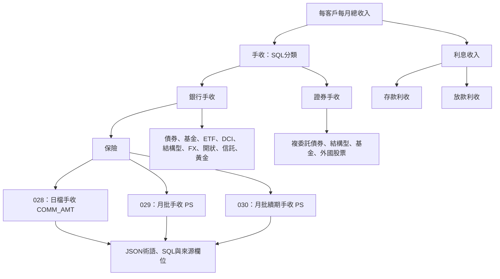

# Income 業務知識圖譜

本圖以 `Income Ontology.json` 的90個術語、收入staging SQL與兩份收入metadata建立。
業務字典記錄現行SQL與推論，未經業務核定的項目會保留狀態；圖中沒有客戶收入實際金額。

業務字典：`Income_business_dictionary.json`。合併圖計畫：`Income_graph_plan.json`。
共9個業務指標、20個產品概念、55個staging輸出、20個計算規則。
20個產品概念中，19個依現行SQL有分類路徑；集合管理帳戶是定義存在但SQL分支被遮蔽的概念。



## 現行串聯邏輯

24條來源以 `UNION` 合成 `INCOME_TMP01`，再依客戶與認列月份連接 `PB_CUST_005`，形成 `INCOME_TMP02`。
`10._INCOME_ROA.sql` 的收入子查詢按 `CUST_ID × SUBSTR(YYYYMMDD,1,6)` 執行 `SUM(AMT)`。
收入日期依產品規則認列，沒有另取月底最新一筆。

`INCOME_REPORT` 則只保留有 `PRFT_CNTR_CD` 的列，按日期、收入類型、機構、產品與組織加總。
它的 `CNT=COUNT(*)` 是來源列數，不能視為不重複客戶數。ROA客戶月份母體為 `PB_CUST_TMP06`，
與組織報表的篩選範圍不同。ROA檔案目前彙總收入、AUM與放款欄位，未實作註解中的比率除法。

| 收入類型 | 產品 | staging輸出 |
|---|---|---|
| 銀行手收 | 保險（日檔／月批／續期） | INCOME_028、029、030 |
| 銀行手收 | 海外債券信託／外國債券自營 | INCOME_031、032 |
| 銀行手收 | 基金／ETF／海外股票 | INCOME_033_034_035_036，以FH_TYP分類 |
| 銀行手收 | DCI | INCOME_037、038 |
| 銀行手收 | 境內結構型（SI／ELI／FCI） | INCOME_039、040、041 |
| 銀行手收 | 境外結構型 | INCOME_042 |
| 銀行手收 | FX | INCOME_043、044 |
| 銀行手收 | 開狀 | INCOME_045 |
| 銀行手收 | 規劃型信託／保管 | INCOME_046、047、048 |
| 銀行手收 | 黃金 | INCOME_049 |
| 證券手收 | 複委託債券／結構型商品 | INCOME_051_054，以FLG分類 |
| 證券手收 | 複委託基金 | INCOME_052 |
| 證券手收 | 複委託外國股票 | INCOME_053 |
| 利收 | 存款／放款 | INCOME_066、067 |

## 已標記的口徑與差異

- **保險三來源都有納入SQL。** metadata將029稱為月批保險手收、030稱為月批續期手收；028是日檔。`UNION`只去除完全相同的輸出列，未按保單去重。日檔與月批是否互斥仍待確認。metadata業務表指定029/030取PS，欄位表將PS稱客戶貢獻度。
- **證券認列月份。** 交易／清算日大於等於行事曆的 `LAST2_WD` 時歸入次月，日期輸出為該月01日。
- **正負號依來源。** 自營外國債券032使用 `ABS(INC_AMT_NT)`；證券外國股票053保留 `(CFEE-ABFEE)*FXRATE` 的來源正負號。
- **集合管理帳戶分類被遮蔽。** TA/TB/TD/TE先命中第一個 `NOT IN` 條件，被歸到基金；圖以 `DECLARES_PRODUCT` 保留業務定義。
- **開狀計價有差異。** metadata描述 `FEE_AMT ÷12 * 前日清算匯率`，SQL為 `SUM(FEE_AMT)`。
- **存款月更新去重。** 歷史初始化使用 `UNION ALL`，上月更新改用 `UNION`；不同存款來源若彙總列剛好完全相同，可能被去重。
- **其他待核對事項。** 基金現況引用債券快照日、外國股票AM來源仍為_M、員工持股費用可能累計、客戶月份組織連接唯一性、台幣現況收入涵蓋範圍，以及被註解的歷史TMP01前置表。

## 在Neo4j查看

開啟 <http://127.0.0.1:7474/browser/>，執行 `Income_browser_queries.cypher` 中的查詢。
第一段顯示業務主幹；第二段顯示三條保險來源；第三段可追到來源欄位；第四段列出待確認規則。

## 重新建立與匯入

從工作區根目錄執行。建立圖計畫只讀來源檔案；匯入工具使用Neo4j本機Query API。

```powershell
python 'ontology\build_income_graph.py'
python "$env:USERPROFILE\.codex\skills\ontology-business-neo4j\scripts\import_graph_plan.py" 'ontology\Income_graph_plan.json' --check-only
$env:NEO4J_PASSWORD = '<your Neo4j password>'
python "$env:USERPROFILE\.codex\skills\ontology-business-neo4j\scripts\import_graph_plan.py" 'ontology\Income_graph_plan.json'
Remove-Item Env:\NEO4J_PASSWORD
```

所有穩定鍵以 `income:` 開頭。同份計畫可重複合併；刪除或重新分類的舊概念不會自動清除，需核對後再做範圍內調整。
