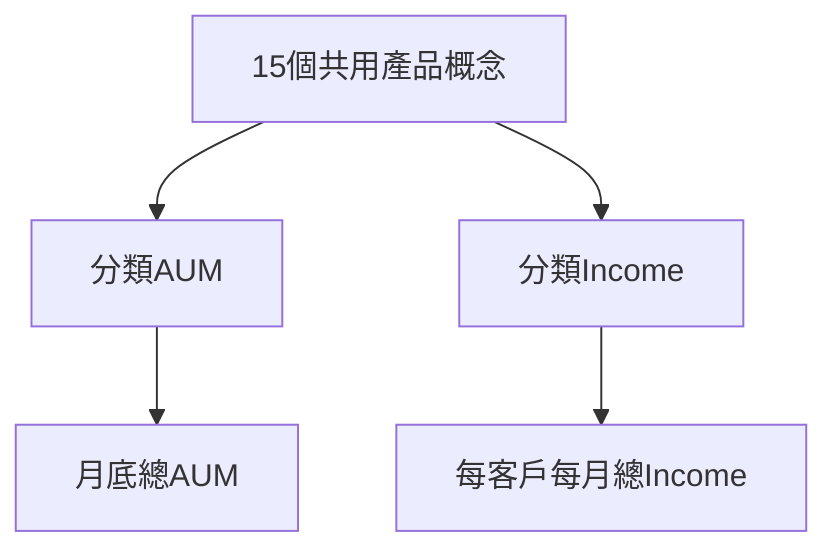

# 共用產品中心圖譜：試作版

> 2026-10-06：本文件所述既有圖現在直接作為資料表映射圖保留。真正獨立儲存、沒有共用節點或跨圖關係的新概念圖，請見 [independent_concepts/README.md](independent_concepts/README.md)。n8n 第一段應使用該目錄的固定概念欄位查詢；本文件的舊圖查詢仍可能包含技術資訊。

> 2026-10-09：映射圖已另新增 `MappingCustomer`，十二個共用產品路徑指標直接以 `MEASURES_CUSTOMER` 連到它。基本資訊仍為客戶 properties，並保留原 AUM／Income 客戶維度與來源證據。原有節點及關係保持原狀；兩張圖維持隔離。第一段主圖與血緣查詢已補客戶，詳見 [mapping_customer/README.md](mapping_customer/README.md)。以下 27／40 與 75 關係是新增客戶前的試作統計。

以 `ontology-business-neo4j` Skill 的業務字典及來源追溯流程建立。0.2版補回分類與彙總層，採用使用者確認的方向：

## 試作範圍

- 新增15個 `SharedProduct:ProductCategory` 節點，命名空間 `pb_shared`。
- 主圖共27個節點、40條關係：15個共用產品加12個兩側指標；完整顯示相關分類與彙總層。產品到分類AUM共15條；到分類Income共14條；到Income待確認定義共1條。
- 共用層包含75條關係：產品到分類指標30條、指標向父層彙總11條、產品到來源staging34條。放款利收的彙總邊也保留，但放款沒有共用產品，因此不在這版主圖路徑內。
- 產品先指向分類AUM或Income，再逐層指向父指標；沒有指標反向指向共用產品。舊0.1版的產品直接連總額30條邊已按來源標記移除，避免跳過分類。
- 原AUM及Income節點保留，共用層引用既有指標與來源。此版只展示共用概念；台股、DCI、境內結構型、FX、開狀、黃金、放款等單側項目仍在原圖。
- 這是產品定義與計算來源的知識圖譜，尚無客戶金額資料。主圖連線不代表AUM与Income可相加、可逐筆配對或能按此關係重算總額。

## 共用概念

存款、銀行保險、銀行基金、銀行ETF、銀行海外股票、海外債券（信託）、海外債券（自營）、集合管理帳戶、銀行境外結構型商品、規劃型信託、信託保管、證券複委託債券、證券複委託結構型商品、證券複委託基金、證券複委託外國股票。

## 映射與例外

1. **集合管理帳戶**：AUM有此分類；Income CASE前面的NOT IN先把TA/TB/TD/TE分到基金，集合分支不可達。用 `INCOME_DEFINITION_PENDING` 和 `INCOME_DECLARED_BY` 表示待確認，排除於14條一般收入映射之外。
2. **存款**：共用的是存款總類。AUM的台幣、外幣、結構型分類保留在原圖；Income利收不能以同一總額重複分配到三個子類。月更新SQL同時涵蓋台幣、外幣及員工台幣歷史帳戶表；原Income字典的「現況僅外幣」指TMP03的非歷史現況表，與上月重載的歷史表來源不同。
3. **信託／保管**：把Income舊的規劃型信託分類拆映射為046、047的規劃型信託，以及048的信託保管；原SQL分類不變。
4. **銀行與證券**：基金、股票、債券、結構型商品仍按通路分開；DCI與結構型存款的對應未建立。
5. **保險**：AUM為原始投資金額，Income的028、029、030來源全部保留。日檔、月批及續期的重複計入問題仍未解決。
6. **AUM根指標**：既有總AUM定義仍是 `draft_metric_query`；此版未把它提升為已確認的正式計算規則。產品映射為推論，使用者已確認的是箭頭方向。

## 查詢與重跑

`Shared_product_browser_queries.cypher` 包含完整業務主圖、排除待確認分支的主圖、保險的業務與技術來源追溯、字典表格，以及全共用產品加來源Stage的查詢。

Neo4j Browser的自動佈局不保證上下位置；上下位置屬視覺排列，不會改變資料中的方向。重跑查詢可能重新佈局，資料中的箭頭方向不受影響。

`build_shared_product_graph.py` 產生業務字典與計畫；`import_shared_product_graph.py --check-only` 先驗證，之後不带此參數匯入。匯入時需提供環境變數 `NEO4J_PASSWORD`。

因為要連結兩個已存在的ontology，計畫採用 `externalReferences` 擴充：先確認每個既有端點恰好一個、標籤符合，再只合併共用層節點、產品向分類指標與來源的關係，以及子指標向父指標的共用層關係。外部節點屬性與原ontology的關係不修改。密碼不寫入輸出檔案。

## 驗證

`Shared_product_graph_validation.json` 記錄節點／關係數、反方向關係零筆、孤立產品零筆、重複關係零筆、各產品經分類層到兩側總額的完整路徑、ontology詞條追溯數及重跑結果。

## 業務分色

- 藍色 `AUMMetric`：AUM業務指標（#4C8EDA）。
- 橘色 `IncomeMetric`：Income業務指標（#F79767）。
- 綠色 `SharedProduct`：兩側共用的產品概念（#8DCC93）。

這個共用概念層是依兩份ontology、SQL及業務字典整理的映射層；原始JSON詞條與各自的來源血緣仍保留。

原本的BusinessMetric標籤與查詢保留，匯入器會自動補上AUMMetric及IncomeMetric。Neo4j Browser已透過節點樣式介面套用分色；主圖為6個藍色AUM指標、6個橘色Income指標、15個綠色共用產品。

`Business_graph_colors.grass` 保存三色樣式及原有其他類型樣式；`Business_graph_original.grass` 保存調整前的樣式。顏色是Browser顯示設定，重跑原主圖Cypher即可使用；其他瀏覽器需另行匯入樣式。標籤樣式与優先序的設定方式可參考[Neo4j官方文件](https://neo4j.com/docs/browser/operations/browser-styling/)。
